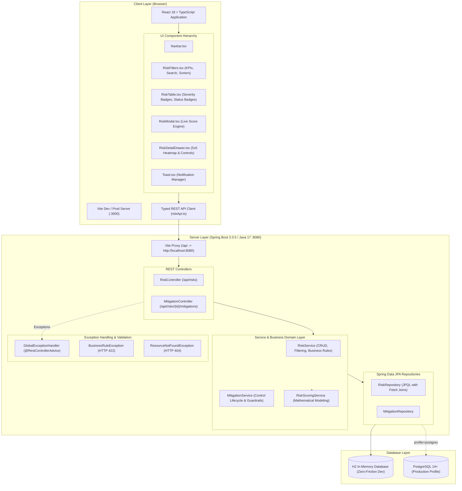
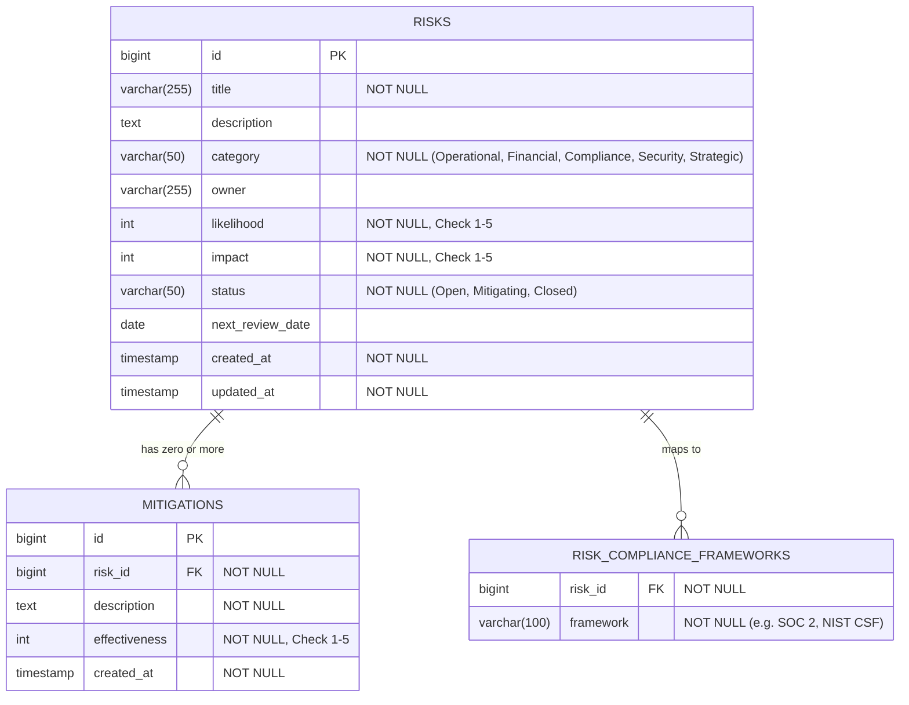
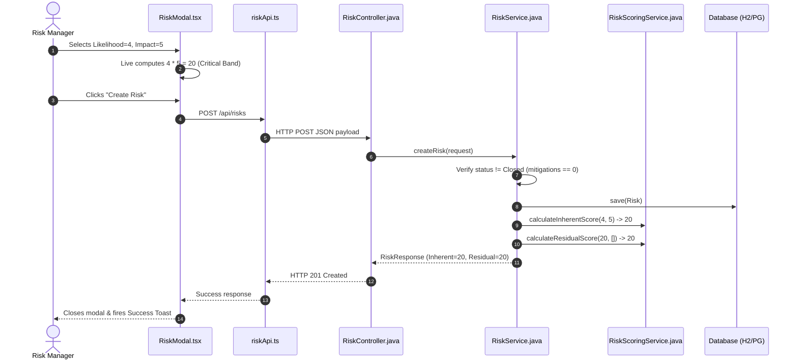
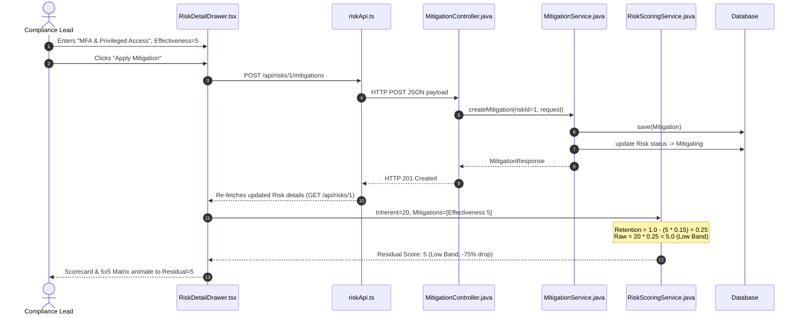
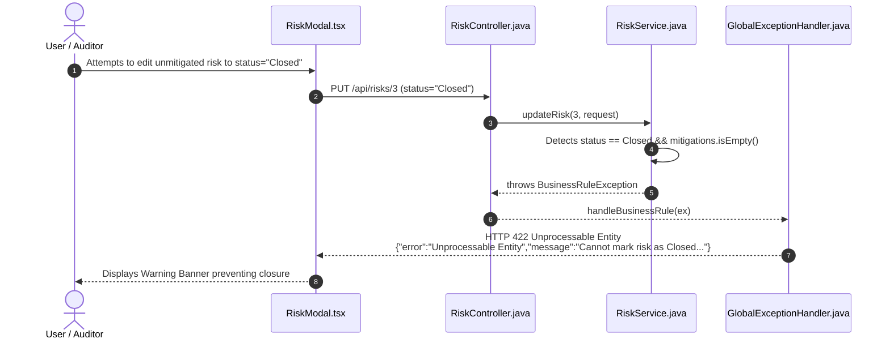

# Hyperproof Risk Register — End-to-End System Design & Architecture

## Table of Contents
1. [Executive Summary & Purpose](#1-executive-summary--purpose)
2. [Domain & Compliance Background](#2-domain--compliance-background)
3. [End-to-End System Architecture](#3-end-to-end-system-architecture)
4. [Data Model & Relational Schema](#4-data-model--relational-schema)
5. [Mathematical Risk Scoring Engine](#5-mathematical-risk-scoring-engine)
6. [Compliance Business Rule: Closing Risks](#6-compliance-business-rule-closing-risks)
7. [Backend Architecture & Implementation (Spring Boot)](#7-backend-architecture--implementation-spring-boot)
8. [Frontend Architecture & Implementation (React + TypeScript)](#8-frontend-architecture--implementation-react--typescript)
9. [End-to-End Data Flow Sequences](#9-end-to-end-data-flow-sequences)
10. [Testing & Verification Strategy](#10-testing--verification-strategy)
11. [Quick-Start & Operational Guide](#11-quick-start--operational-guide)
12. [Trade-offs & Future Enterprise Roadmap](#12-trade-offs--future-enterprise-roadmap)

---

## 1. Executive Summary & Purpose

The **Hyperproof Risk Register** is a full-stack compliance and risk management system designed to turn fuzzy organizational risk concepts into a structured, mathematically sound, audit-ready product feature.

Organizations use Hyperproof to track organizational threats, evaluate raw exposures, design and apply defense-in-depth controls, and demonstrate to independent auditors (SOC 2, ISO 27001, NIST CSF, FedRAMP) that residual risks are actively measured and reduced.

### Core Objectives
- **Data Integrity & Consistency:** Prevent data drift by computing scores dynamically rather than relying on stale denormalized columns.
- **Mathematical Soundness:** Eliminate naive linear risk reductions; model compounding defense-in-depth with diminishing marginal returns.
- **Audit Defensibility:** Prevent closing unmitigated risks, ensuring zero control deficiencies during external audits.
- **Cognitive Clarity:** Give risk managers and executives instant visual feedback via a standardized 4-tier severity band and an interactive 5×5 risk matrix.

---

## 2. Domain & Compliance Background

### The Role of a Risk Register
A Risk Register is the central source of truth for an organization's risk management program. It tracks risks across five critical operational domains:
- **Security:** Vulnerabilities, data leaks, credential theft, ransomware.
- **Operational:** Cloud vendor outages, infrastructure single points of failure, supply-chain interruptions.
- **Compliance:** Regulatory breaches (GDPR, HIPAA, CCPA, SOX), audit SLA delays.
- **Financial:** Currency volatility, cash flow exposure, customer concentration risk.
- **Strategic:** Loss of key personnel, market disruption, competitor intellectual property moves.

### Inherent vs. Residual Risk
```
┌─────────────────────────────────────────────────────────────┐
│ INHERENT RISK (Raw Exposure)                                │
│ Likelihood (1–5) × Impact (1–5)                             │
│ Assessment of exposure before any controls exist.           │
└──────────────────────────────┬──────────────────────────────┘
                               │
                               ▼
               [ Mitigating Controls Applied ]
               - Layer 1: Hardware-backed MFA (Effectiveness: 5)
               - Layer 2: SIEM Anomaly Alerts (Effectiveness: 4)
                               │
                               ▼
┌─────────────────────────────────────────────────────────────┐
│ RESIDUAL RISK (Current Exposure)                            │
│ Compounded Multiplicative Retention Formula                 │
│ What risk actually remains to the business today.           │
└─────────────────────────────────────────────────────────────┘
```

Auditors evaluate not just whether risks exist, but the delta between **Inherent** and **Residual** risk to verify that controls are effective.

---

## 3. End-to-End System Architecture

The application is structured into decoupled, single-responsibility layers:



---

## 4. Data Model & Relational Schema

### Entity-Relationship Diagram



### Relational Integrity & JPA Mapping
- **Cascade Deletion:** `Risk` entity uses `@OneToMany(mappedBy = "risk", cascade = CascadeType.ALL, orphanRemoval = true)`. Deleting a risk safely purges all associated mitigations and framework mappings.
- **Fetch Optimization:** Query methods in `RiskRepository` use `LEFT JOIN FETCH r.mitigations` to eliminate the classic **$N+1$ query problem** when rendering the register table.
- **Audit Timestamps:** Handled via `@PrePersist` and `@PreUpdate` lifecycle callbacks for accurate `createdAt` and `updatedAt` tracking.

---

## 5. Mathematical Risk Scoring Engine

### Why Linear Subtraction Fails
Many early risk platforms use linear formulas: $\text{Residual} = \text{Inherent} - \sum \text{Effectiveness}$.
This causes three severe defects:
1. **Negative Scores:** Two level-4 mitigations on an inherent risk of 6 yields $-2$.
2. **False Elimination:** Five low-quality procedural memos ($5 \times 1 = 5$) could supposedly reduce a catastrophic risk (25) to a minor level.
3. **No Diminishing Returns:** In reality, the fourth backup system adds less marginal safety than the first.

### Proposed Compounding Multiplicative Retention Formula

In our model (inspired by NIST SP 800-30 and the Swiss Cheese model of accident prevention), each mitigating control represents a barrier that reduces the unmitigated probability or impact.

1. **Effectiveness Rating to Retention Factor:**
   Each effectiveness point ($e_k \in \{1, 2, 3, 4, 5\}$) provides $15\%$ mitigation coverage, leaving an unmitigated retention factor of:
   $$\text{retention}(e_k) = 1.0 - (e_k \times 0.15)$$
   - **$e=1$ (Informal / Weak):** $1.0 - 0.15 = 0.85$ (retains $85\%$ of risk; $15\%$ mitigation).
   - **$e=3$ (Standard Procedure):** $1.0 - 0.45 = 0.55$ (retains $55\%$ of risk; $45\%$ mitigation).
   - **$e=5$ (Automated / Continuously Audited):** $1.0 - 0.75 = 0.25$ (retains $25\%$ of risk; $75\%$ mitigation).

2. **Compounding Multiple Mitigations:**
   $$\text{Retention}_{\text{raw}} = \prod_{k=1}^n \left(1.0 - e_k \times 0.15\right)$$

3. **Residual Risk Floor (Max 90% Mitigation):**
   Active organizational risks can virtually never be $100\%$ eliminated without completely stopping the business activity. We enforce a minimum floor of $10\%$ on unmitigated exposure:
   $$\text{Factor}_{\text{effective}} = \max\left(0.10, \text{Retention}_{\text{raw}}\right)$$

4. **Final Scoring:**
   $$\text{Exact Residual Score} = \text{round}_{\text{2 decimals}}(\text{Inherent} \times \text{Factor}_{\text{effective}})$$
   $$\text{Residual Score (Integer)} = \max\left(1, \min\left(\text{Inherent}, \text{round}(\text{Inherent} \times \text{Factor}_{\text{effective}})\right)\right)$$

### Verification of Sanity Checks
- **Sanity Check 1 (Zero Mitigations):**
  When $n = 0$, the empty product equals $1.0$.
  $$\text{Residual} = \text{Inherent} \times 1.0 = \text{Inherent} \quad (\text{Passed})$$
- **Sanity Check 2 (One Highly Effective Mitigation):**
  For a maximum Critical risk ($L=5, I=5 \implies 25$):
  $$25 \times 0.25 = 6.25 \implies \text{Residual} = 6 \quad (\text{Medium Band, Meaningful 76\% Drop})$$
  For an Inherent risk of $20$:
  $$20 \times 0.25 = 5.0 \implies \text{Residual} = 5 \quad (\text{Low Band})$$
  In all cases, single high-grade mitigations dramatically reduce exposure. $(\text{Passed})$
- **Sanity Check 3 (Never Falls Below 1):**
  Enforced by $\max(1, \dots)$ and the $10\%$ floor. Even an inherent risk of $2$ with four Level-5 controls yields $1$. $(\text{Passed})$

### Severity Bands
| Band | Integer Range | Tailwind Color Tokens | Hex Code |
| :--- | :--- | :--- | :--- |
| **Low** | $1 - 5$ | `bg-emerald-50 text-emerald-700 border-emerald-200` | `#10B981` |
| **Medium** | $6 - 12$ | `bg-amber-50 text-amber-700 border-amber-200` | `#F59E0B` |
| **High** | $13 - 19$ | `bg-orange-50 text-orange-700 border-orange-200` | `#F97316` |
| **Critical** | $20 - 25$ | `bg-rose-50 text-rose-700 border-rose-200` | `#EF4444` |

---

## 6. Compliance Business Rule: Closing Risks

### The Judgment Call
> *"Decide what should happen if someone tries to mark a risk 'Closed' while it has zero mitigations. Implement whatever rule you think is correct for a compliance product, and explain your reasoning in the README."*

### Decision & Compliance Rationale
In enterprise audits (SOC 2 Type II, ISO 27001 Clause 6.1.3, NIST CSF RS.MI), a compliance officer cannot declare an organizational threat resolved without an audit trail of:
1. Operational mitigating controls that reduced likelihood/impact; or
2. A formal risk acceptance / risk transfer control (e.g., insurance policy or formal executive sign-off).

Marking a risk **"Closed"** with zero controls represents an unverified assertion and will trigger an **audit deficiency**.

### Implementation Details
1. **Creation Guard:** Direct creation of a risk in `Closed` status is rejected because it has zero mitigations upon inception.
2. **Transition Guard:** Attempting to update a risk to `status = Closed` while its `mitigations` list is empty throws `BusinessRuleException`:
   > *"Cannot mark risk as Closed because it has zero mitigating controls. Auditors require demonstrable evidence of mitigating controls or accepted residual risk controls before closure."*
3. **Deletion Guard:** If a risk is already `Closed`, deleting its sole remaining mitigation is strictly rejected to prevent leaving an orphaned closed risk without controls.
4. **HTTP Status Code:** Returns **`422 Unprocessable Entity`** rather than a generic 400, cleanly signaling semantic domain rule failure.

---

## 7. Backend Architecture & Implementation (Spring Boot)

### Layered Structure
- **Controller Layer (`com.hyperproof.risk.controller`):**
  - [`RiskController`](file:///Users/jayantbatra/Desktop/TakeHomeAssignment/backend/src/main/java/com/hyperproof/risk/controller/RiskController.java): Handles `GET`, `POST`, `PUT`, `DELETE` on `/api/risks`. Supports query params: `category`, `status`, `sortBy`, `sortOrder`.
  - [`MitigationController`](file:///Users/jayantbatra/Desktop/TakeHomeAssignment/backend/src/main/java/com/hyperproof/risk/controller/MitigationController.java): Handles CRUD for controls at `/api/risks/{riskId}/mitigations`.
- **Service Layer (`com.hyperproof.risk.service`):**
  - [`RiskService`](file:///Users/jayantbatra/Desktop/TakeHomeAssignment/backend/src/main/java/com/hyperproof/risk/service/RiskService.java): Encapsulates transaction boundaries (`@Transactional`), coordinates entity persistence, calls `RiskScoringService`, and sorts by residual score descending by default.
  - [`MitigationService`](file:///Users/jayantbatra/Desktop/TakeHomeAssignment/backend/src/main/java/com/hyperproof/risk/service/MitigationService.java): Coordinates control attachment and automatically promotes risks from `Open` to `Mitigating` when the first control is attached.
  - [`RiskScoringService`](file:///Users/jayantbatra/Desktop/TakeHomeAssignment/backend/src/main/java/com/hyperproof/risk/service/RiskScoringService.java): Pure stateless domain calculation engine.
- **Exception Handling (`com.hyperproof.risk.exception`):**
  - [`GlobalExceptionHandler`](file:///Users/jayantbatra/Desktop/TakeHomeAssignment/backend/src/main/java/com/hyperproof/risk/exception/GlobalExceptionHandler.java): Catches `MethodArgumentNotValidException` (400), `BusinessRuleException` (422), `ResourceNotFoundException` (404), and `HttpMessageNotReadableException` (400), outputting standardized JSON responses.

### Sample REST API Payload & Response

#### Request: `POST /api/risks`
```json
{
  "title": "Unauthorized Access to Production Database",
  "description": "Potential exposure of sensitive customer PII through compromised administrative credentials.",
  "category": "Security",
  "owner": "Security Operations Lead",
  "likelihood": 4,
  "impact": 5,
  "status": "Open",
  "nextReviewDate": "2026-11-20",
  "complianceFrameworks": ["SOC 2 CC6.1", "NIST CSF PR.AC-1"]
}
```

#### Response: `HTTP 201 Created`
```json
{
  "id": 1,
  "title": "Unauthorized Access to Production Database",
  "description": "Potential exposure of sensitive customer PII through compromised administrative credentials.",
  "category": "Security",
  "owner": "Security Operations Lead",
  "likelihood": 4,
  "impact": 5,
  "status": "Open",
  "inherentScore": 20,
  "inherentSeverity": "Critical",
  "residualScore": 20,
  "exactResidualScore": 20.0,
  "residualSeverity": "Critical",
  "mitigationPercentage": 0.0,
  "mitigationCount": 0,
  "mitigations": [],
  "nextReviewDate": "2026-11-20",
  "overdue": false,
  "complianceFrameworks": ["SOC 2 CC6.1", "NIST CSF PR.AC-1"],
  "createdAt": "2026-09-27T04:29:51.589Z",
  "updatedAt": "2026-09-27T04:29:51.589Z"
}
```

---

## 8. Frontend Architecture & Implementation (React + TypeScript)

### Component Tree
```
App.tsx (Root State Coordinator & Toast Provider)
 ├── Navbar.tsx (Branding, Swagger UI Link, Create Trigger)
 ├── RiskFilters.tsx (Aggregated KPI Cards, Status/Category Selects, Search)
 ├── RiskTable.tsx (Primary Dashboard)
 │    ├── SeverityBadge.tsx (Standardized Color-Coded Pill)
 │    └── StatusBadge.tsx (State Indicator with Shield Icons)
 ├── RiskModal.tsx (Create / Edit Modal)
 │    ├── Dynamic Likelihood (1–5) & Impact (1–5) Selectors
 │    └── Live Inherent Score & Severity Band Preview
 ├── RiskDetailDrawer.tsx (Slide-Over Panel)
 │    ├── Inherent vs. Residual Scorecard
 │    ├── RiskScoreMatrix.tsx (Interactive 5×5 Matrix Heatmap)
 │    ├── Mitigation List (Effectiveness Badges, Deletion Trigger)
 │    └── Add Mitigation Form (Real-Time Residual Recalculation)
 └── Toast.tsx (Floating Notification Stack)
```

### Key Frontend Capabilities
1. **Interactive 5×5 Heatmap Matrix (`RiskScoreMatrix.tsx`):**
   Displays the classic $5 \times 5$ grid. It plots a black pill with marker `I` for Inherent Risk position and an indigo pill with marker `R` for Residual Risk position.
2. **Live Inherent Score Preview (`RiskModal.tsx`):**
   As the user clicks through Likelihood ($1 - 5$) or Impact ($1 - 5$) buttons, client-side state calculates $L \times I$ and dynamically updates the badge and color before form submission.
3. **Reactive Mitigations Drawer (`RiskDetailDrawer.tsx`):**
   Adding or removing a mitigation immediately triggers backend re-calculation and updates the scorecard and residual badges without requiring a full page refresh.

---

## 9. End-to-End Data Flow Sequences

### Sequence 1: Creating a Risk with Live Calculation


### Sequence 2: Adding a Mitigation & Compounding Score Reduction


### Sequence 3: Rejecting Closure on Unmitigated Risk (Compliance Guardrail)


---

## 10. Testing & Verification Strategy

The repository includes comprehensive automated test suites covering calculation correctness, business rules, input validation, and end-to-end API integration.

### Test Breakdown

| Test Suite | Class Name | Location | Count | Focus Areas |
| :--- | :--- | :--- | :--- | :--- |
| **Scoring Unit Tests** | [`RiskScoringServiceTest`](file:///Users/jayantbatra/Desktop/TakeHomeAssignment/backend/src/test/java/com/hyperproof/risk/service/RiskScoringServiceTest.java) | `backend/src/test/` | 27 | Inherent scores, severity bands, Sanity Check 1 (zero mitigations), Sanity Check 2 (effectiveness 5 drop), Sanity Check 3 (score $\ge 1$), compounding retention. |
| **Business Rule Tests** | [`RiskServiceBusinessRuleTest`](file:///Users/jayantbatra/Desktop/TakeHomeAssignment/backend/src/test/java/com/hyperproof/risk/service/RiskServiceBusinessRuleTest.java) | `backend/src/test/` | 4 | Prohibiting creation in Closed status; rejecting closing unmitigated risks; permitting closure with mitigations; preventing deletion of sole control on closed risks. |
| **Validation Tests** | [`RiskControllerValidationTest`](file:///Users/jayantbatra/Desktop/TakeHomeAssignment/backend/src/test/java/com/hyperproof/risk/controller/RiskControllerValidationTest.java) | `backend/src/test/` | 5 | Rejection of Likelihood/Impact/Effectiveness $< 1$ or $> 5$; rejection of blank titles or descriptions. |
| **E2E Integration** | [`RiskManagementApiIntegrationTest`](file:///Users/jayantbatra/Desktop/TakeHomeAssignment/backend/src/test/java/com/hyperproof/risk/integration/RiskManagementApiIntegrationTest.java) | `backend/src/test/` | 1 | Full MockMvc lifecycle: Create Risk $\rightarrow$ Verify Initial Score $\rightarrow$ Add Mitigation $\rightarrow$ Verify Residual Drop $\rightarrow$ Close $\rightarrow$ Test Deletion Guard. |
| **Frontend Tests** | `scoring.test.mjs` | `frontend/tests/` | 6 | Client-side score calculation, severity bands, and sanity checks via Node Test Runner. |

---

## 11. Quick-Start & Operational Guide

### One-Command Startup
To start both backend and frontend concurrently:
```bash
./start.sh
```

### Manual Individual Startup

#### 1. Backend
```bash
cd backend
export JAVA_HOME=/opt/homebrew/opt/openjdk@17 # Or your local JDK 17
mvn spring-boot:run
```
*Access Swagger UI at:* `http://localhost:8080/swagger-ui.html`

#### 2. Frontend
```bash
cd frontend
npm install
npm run dev
```
*Access the Web Application at:* `http://localhost:3000`

### Running Tests
- **Backend (37 tests):** `cd backend && mvn test`
- **Frontend (6 tests):** `cd frontend && npm test`

---

## 12. Trade-offs & Future Enterprise Roadmap

### Trade-offs Made
1. **In-Memory H2 vs. Dedicated PostgreSQL:**
   - *Chosen approach:* Defaulted to H2 in-memory with seed data to ensure reviewers can run the application with zero Docker or local database setup in under two minutes.
   - *Production mitigation:* Provided an `application-postgres.properties` profile and PostgreSQL driver dependencies for instant cloud or container deployment.
2. **Dynamic Calculation vs. Stored Columns:**
   - *Chosen approach:* Inherent and residual scores are dynamically computed on read requests.
   - *Benefit:* Eliminates database synchronization errors or race conditions when controls are added/deleted concurrently.

### Future Enterprise Enhancements
1. **Audit Trail & Point-in-Time History (Hibernate Envers):**
   Maintain immutable snapshots of risk assessments over time to generate historical trend reports for quarterly board meetings.
2. **Continuous Automated Evidence Collection:**
   Connect directly to cloud providers (AWS IAM, CloudTrail, GitHub branch protections) to automatically recalculate control effectiveness based on live configuration telemetry.
3. **Quantitative Financial Modeling (FAIR Model):**
   Extend qualitative $1 - 5$ ordinal scoring with quantitative financial loss modeling (Annual Loss Expectancy in USD).
